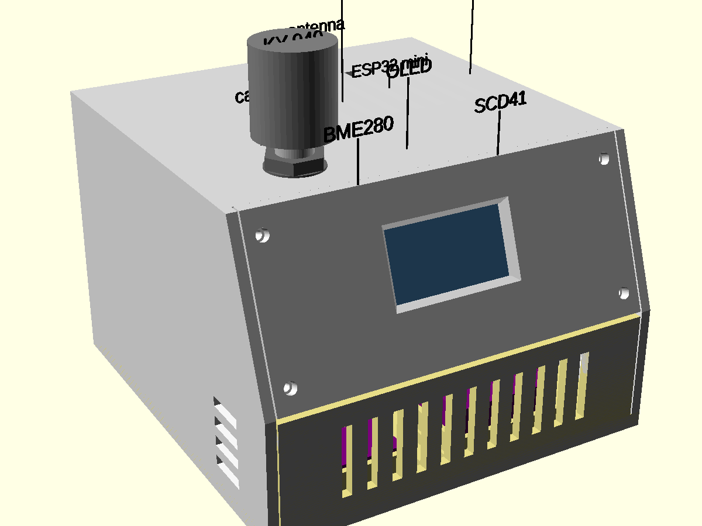
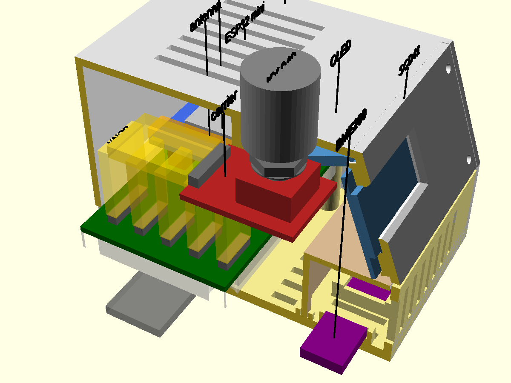
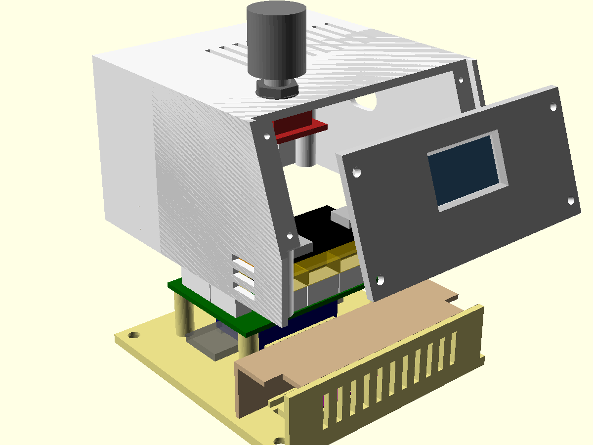
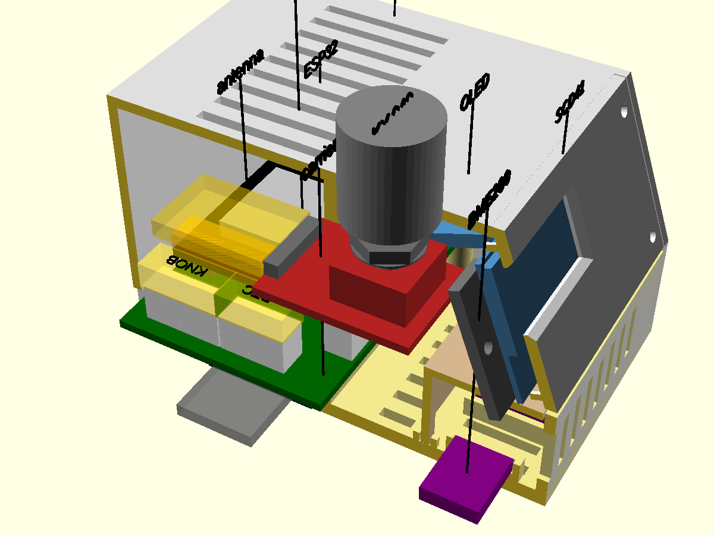
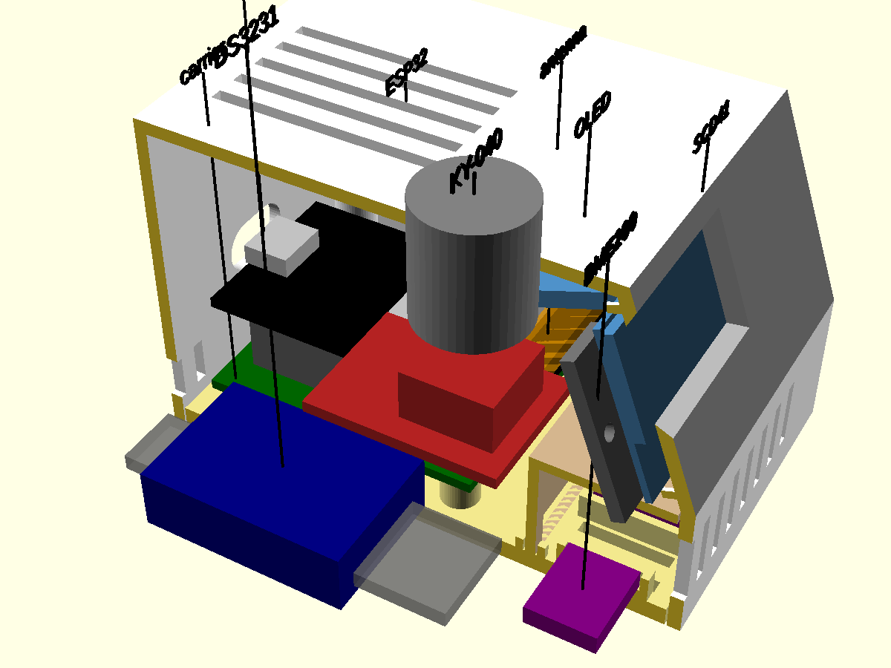
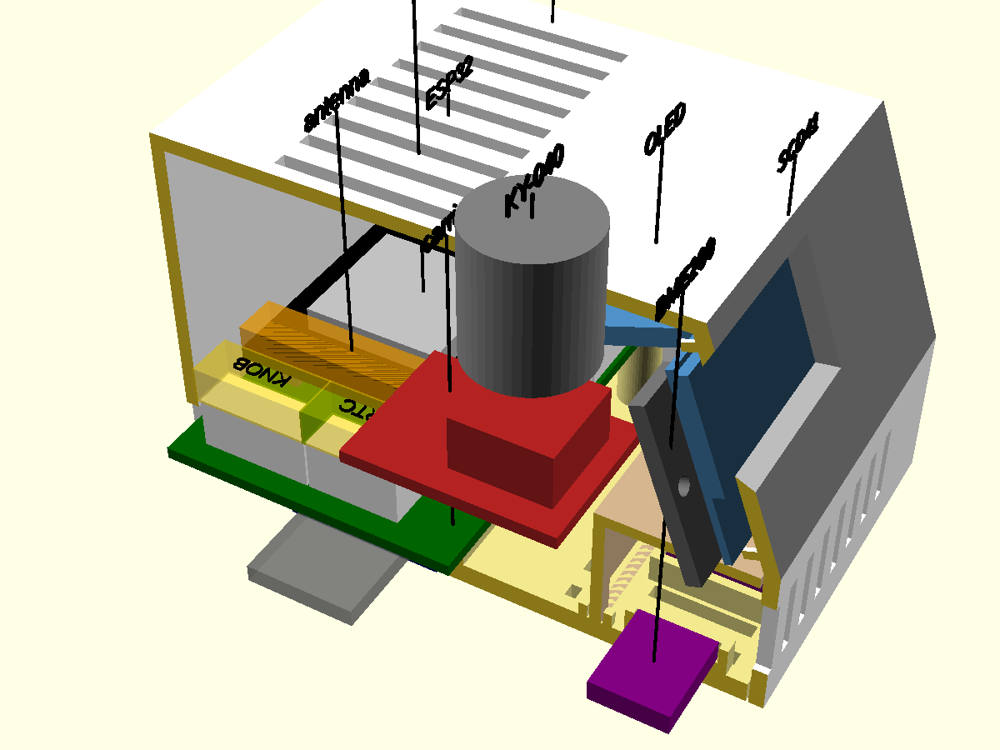
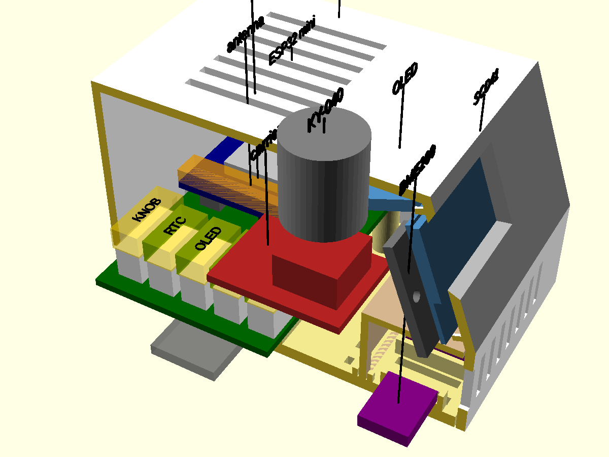

# Enclosure (ROADMAP task 15)

OpenSCAD model of the case, written from `MEASUREMENTS.md`. **The one to
print is `enclosure_v4.scad`** (see "v4" below); the sections after it
(Layout, Parts, Hardware, checklists) describe v1. Open
`enclosure.scad` in OpenSCAD for the assembled view (modules shown as
coloured stand-in blocks). `-D cut=40` cuts the printed parts away left of
x = 40 to show the inside.

Part dimensions and how each part can be held: its Homebox entry
(`python3 ../../grappim-watcher/docs/esp32/inventory/parts.py show <part>`).
General modelling, clash-check and printability lessons:
`../../grappim-watcher/docs/esp32/ENCLOSURE_PLAYBOOK.md`. This file is this case only.

```
enclosure/export.sh   # clash check, then stl/enclosure/*.stl (gitignored) + renders/enclosure-*.png
```

The clash check fails if any printed part overlaps a module stand-in.

To look inside: **Window → Customizer**, untick `show_shell` (also
`show_base`, `show_hood`, `show_clamps`, `show_labels`), or set `cut`.
Stand-in colours: OLED steel blue, ESP32 black (antenna end orange),
carrier green, DS3231 navy, KY-040 red with a grey cap, sensors purple;
`show_labels` puts their names over them.

 

## v4: the case to print (`enclosure_v4.scad`, 2026-10-18)

**The current model.** For the project's first finished build: DevKit,
OLED, KY-040, SCD41, BME280, DS3231, no battery. v2's `whole` layout
(below; the user's cardboard mock-up is of it) with the fixes mukklet's two
printed cases taught (`../../esp32-mukklet/enclosure/`):

| | v2 | v4 | why |
|---|---|---|---|
| screen panel | part of the shell | own **front plate**, 4 × 2 × 6 from the front, heads visible | no screwdriver reaches the OLED clamps' screws in a one-piece shell (axis runs into the back wall, ~79 mm); a wrong window costs one small plate |
| strip under the screen | shell | **base** | on the body it's a 76 mm bridge, printed upside down |
| base | inside the walls | **whole footprint**, the walls stand on it | holes were 0.5 from its edge; mukklet v1 had the same at 0.2 |
| base screws | 3.4 hole, pilot 11 | 4.0 hole, pilot 13 | the kit's "M3 × 10" is 3.64 × 11.7 |
| knob | 16 hole, 2 snap hooks | **7.3 hole, its own M7 nut** + 2 anti-turn ribs; moved 3 mm right (x 19) | mukklet v1's hooks didn't hold, v2's nut does |
| OLED clamps | posts flush with the PCB | posts 0.3 short, so the bars press; 2 × 4 | |
| carrier standoffs | pilot 1.7 | 1.6, 2 × 6 | 2.3 into 1.9 snapped in mukklet; 2.0 into 1.6 worked |
| window | chamfer from 0.5 in | 1.2 straight, then the chamfer | hubs.com flags a knife edge |

`export.sh` now also fails on the pre-print asserts in the model (edge
distances, pilot depth vs screw reach, gaps, thread above the nut), prints
their margins (`CHECKS:`) and lists every `ASSUMED` value, and clash-checks
printed parts against each other and stand-ins (plugs included) against
each other.

```
enclosure/export.sh enclosure_v4.scad      # -> stl/enclosure_v4/{body,front,base,hood,clamp,test_knob}.stl
enclosure/cardboard.py 2 enclosure_v4.scad
```

 

**Parts to print** (PETG preferred, clearance 0.3): `body` (upside down,
check the USB hole's bridge), `front` (face down), `base` (flat), `hood`
(roof down), `clamp` (2 in the file). `test_knob` is optional (the top's
front with the knob mount).

**Hardware**: 4 × M3 × 10 round head, silver kit (base → body); 4 × 2 × 6
black (front plate → rails); 2 × 2 × 4 black (OLED clamps); 4 × 2 × 6
black (carrier → standoffs, holes drilled 2.5 in the perfboard); 4 rubber
feet ≥ 2 mm.

**Assembly**: carrier screwed onto the standoffs *before* the ESP32 goes
into its sockets (a driver above two of the holes hits the ESP32); DS3231
into its holder under it first. Sensors into their pockets, hood on. Knob
up through the top, washer + nut from outside, cap on. OLED onto the plate
with the two clamp bars (plate on the desk). Cables onto the carrier, plate
onto the body (4 screws from the front), body down onto the base (4 screws
from below).

**Before ordering** (gone through the `enclosure-preprint-review`
checklist 2026-10-18; open items):
1. **Measure the female headers' height** (`hdr_h` = 8.5 assumed): it sets
   the ESP32's height and so the USB hole's (8 tall for a ~6.5 plug: ±0.75
   of margin).
2. Where the perfboard's hole grid sits (assumed centred): shifts the USB
   sideways (13 wide for a ~12 plug).
3. The OLED's lit area (±0.5 from a photo): the window is lit + 0.5 all
   round. On the printed plate the time (flush left), the date's last digit
   (flush right) and the bottom row must show in full; else only the plate
   is reprinted.
4. The knob's right-angle header (~6 out, from a photo) and its Dupont plug
   point back over the carrier's KNOB socket; the clash check passes them.

**ESP32 mini later?** `enclosure_v3.scad` still has v2's shell, base and
snap hooks: it needs the same fixes before it's printed.

## v2: the carrier is the 4 x 6 cm board (`enclosure_v2.scad`)

The mock-up (2026-09-28) showed v1's carrier can't work: the 4 x 6 cm
perfboard has 14 holes across its 4 cm side, and an ESP32 pin row is 15, so
the ESP32 only fits along the 6 cm side. `enclosure.scad` (v1) is kept;
`enclosure_v2.scad` has two layouts, `carrier` in the Customizer:

| | `cut` | `whole` (**picked 2026-10-03**, the default) |
|---|---|---|
| board | turned front-to-back, cut to 40 x 44 (keep 17 hole rows) | uncut 60 x 40 |
| ESP32 | front-to-back | left-to-right |
| USB-C | out the back | out the right side |
| antenna | hangs off the board's front edge | over the board (and under the knob) |
| DS3231 | own holder on the floor, left, JST cable | own holder on the floor under the carrier (tall 16 mm standoffs), JST cable |
| case size | same 80 x 84 x 54 | same |

```
enclosure/export.sh enclosure_v2.scad carrier=cut        # or carrier=whole
enclosure/cardboard.py 2 enclosure_v2.scad carrier=cut   # -> cardboard-enclosure_v2-cut.pdf
```

**JST-XH sockets** are modelled on the board's hole grid (white, with the
mated plug + cable bend as a see-through gold block, labelled on top); the
clash check covers them against the ESP32, its headers, the DS3231 and the
case, and the model errors if one hangs off the board:

- `whole`: all five fit. BME280, SCD41, OLED along the front edge (row 0,
  under nothing; the plugs clear the ESP32's edge by only ~0.5 mm in plan),
  RTC and KNOB at the left end (col 0), next to the ESP32's antenna end.
- `cut`: only three fit (KNOB, OLED, SCD41, in the one free column left of
  the ESP32). **No room for BME280 and RTC**: the ESP32 covers the rest of
  the board, and a plug is too tall to go under it.

The hole grid is ASSUMED centred on the board. The DS3231's pins (both
ends) are modelled with the cable soldered on, not a Dupont plug.

 

## v3: ESP32 mini instead of the DevKit (`enclosure_v3.scad`, 2026-10-03)

Was the current model until v4 (the build stays on the DevKit). v2's `whole` layout (board uncut, USB-C out the right
side) with the ESP32 mini (D1 mini layout, 31.5 x 39 mm) in place of the
DevKit. The mini plugs into four 10-pin female headers (pad lines in rows
1, 2, 11, 12; pads in cols 10-19), its USB end hangs ~3 mm off the board's
right edge. All five JST-XH sockets stack at the board's left end (cols
0-4, rows 0/3/6/9/12, pin lines along X), ~5 mm from the mini's antenna
end. Case size unchanged. Why the mini: it fits the board either way round,
so all sockets fit with the USB out the side. Its regulator (marked
`73L33`) has no known rating: a full-load test follows the soldering.

```
enclosure/export.sh enclosure_v3.scad
```



## Cardboard mock-up

```
enclosure/cardboard.py [cardboard mm, default 2] [file.scad] [var=value]   # -> enclosure/cardboard*.pdf (gitignored)
```

Two A4 pages of 1:1 templates, sized from the model: 2 sides, front strip,
screen panel (with the window), top (with the knob hole), back (with the
USB hole), and a floor with the modules' outlines drawn on it (not holes) to lay the real ones on. Print at 100%
("Actual size") and check the 50 mm bar with a ruler. Panels other than the
sides are narrower by 2 × the cardboard thickness, so they fit between the
sides. The mock-up checks size, screen angle, knob reach, and cables and
battery space; not the printed fits or the heat.

## Layout

80 x 84 x 54 mm (W x D x H). A wedge: the OLED sits on a panel tilted 20°
back, with a vented strip under it and the knob on top (left).

- **Sensor bay** (BME280, SCD41): low at the front, walled off by the `hood`
  (a roof and back wall). Air comes in through the floor slots and leaves
  through the front and side slots. Nothing warm is inside it. Sensor cables
  go out through a notch in the hood's back wall. The bay is ~16 mm tall
  inside, so **solder the sensor cables straight on, or use right-angle
  pins**: a vertical header with a Dupont plug on it doesn't fit.
- **ESP32**: sits on the carrier board at the back right, with USB-C out the
  back. Its antenna end hangs off the carrier's front edge (no copper under
  it) and has nothing above it. Top slots over it let its warm air out;
  intake slots are low on the back and in the floor.
- **Carrier board**: 60 x 40 mm cut from a Miuzei perfboard, on 4 standoffs
  (5 mm). Place it on the printed base, mark the standoff holes through, and
  drill them to 2 mm. The ESP32 and DS3231 plug into 8.5 mm female headers.
- **OLED**: glass flat against the panel's inner face, located by 4 corner
  stops, held by two printed clamp bars. Each bar is screwed to a post
  beside the board and presses on the PCB's side edge. The board's own
  corner holes aren't used: the glass reaches almost to them, so there's no
  room for a screw post. Pins face up. If the picture comes out upside down,
  flip the two orientation bytes in `display.c`, not the board.
- **Knob**: the KY-040 board sits flat under the top, pins to the back. Push
  it up into two snap hooks on its long edges and it rests against 4 pads.
  The cap goes on from outside afterwards.
- **Base**: the floor plate goes into the open bottom of the shell. It's held
  by 4 × M3 screws from below into the shell's corner bosses, so the case
  opens without touching the wiring. There's room left for a battery later.

## Parts to print

| STL | Qty | Orientation (as exported) | Notes |
|---|---|---|---|
| `shell` | 1 | upside down, top on the bed | no supports expected; check the USB hole's 13 mm bridge |
| `base` | 1 | flat | |
| `hood` | 1 | roof on the bed | |
| `clamp` | 2 (file has both) | flat | |
| `test_front` | 1 | like the shell | **print this first**: screen panel + top front with the knob mount |

Material: PETG preferred (PLA softens ~55 °C, e.g. in direct sun). Fit
clearance in the model is 0.3 mm (`clr`): ask the person printing it.

## Hardware

- 4 × M3 × 8 self-tapping (base → shell)
- 2 × M2 × 5 self-tapping (OLED clamp bars)
- 4 × M2 × 6 self-tapping (carrier board → standoffs)
- 4 self-adhesive rubber feet, ≥ 2 mm tall (they lift the floor slots off the desk)
- JST-XH connectors and cables, see ROADMAP task 15

## Assumed, not measured

Marked `ASSUMED` in `enclosure.scad`; the test print shows whether they're
right: the OLED lit area's
position (±0.5 from a photo), the EC11 body size, the ESP32/KY-040 PCB
thickness (1.6), and the female header height (8.5).

## Test print checklist (`test_front`)

1. OLED: the glass sits flat between the 4 stops, and the lit area is
   centred in the window with no dark edge.
2. The clamp bars screw down without bending the board.
3. KY-040: it snaps in, the shaft is centred in the 16 mm hole, and the cap
   turns and presses without rubbing the top.
