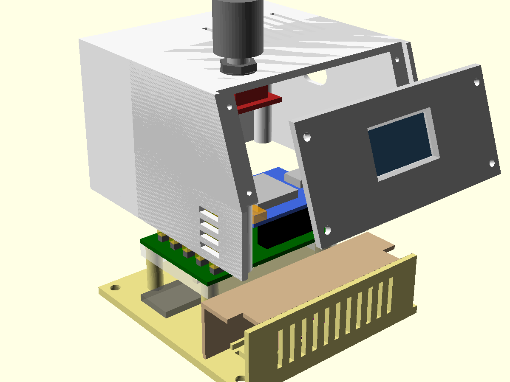
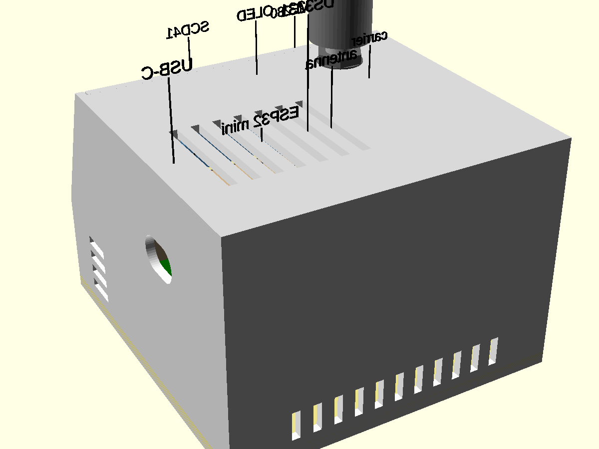

# Enclosure (ROADMAP task 15)

OpenSCAD model of the case, `enclosure.scad`, for the first finished build:
ESP32 mini, OLED, KY-040, SCD41, BME280, DS3231, no battery. Open it in
OpenSCAD for the assembled view (modules as coloured stand-in blocks,
see-through gold = plugged-in connectors). `-D cut=40` cuts the printed
parts away left of x = 40; `-D explode=40 -D explode_front=30` pulls the
parts apart.

Part dimensions and how each part can be held: its Homebox entry
(`python3 ../../grappim-watcher/docs/esp32/inventory/parts.py show <part>`).
General modelling, clash-check and printability lessons:
`../../grappim-watcher/docs/esp32/ENCLOSURE_PLAYBOOK.md`. This file is this
case only. Earlier models (v1-v3: the ESP32 across the 4 cm side, the cut
carrier, the ESP32 mini) are in git history before 2026-10-18.

```
enclosure/export.sh      # checks, then stl/enclosure/{body,front,base,hood}.stl (gitignored) + renders/
enclosure/cardboard.py   # 1:1 A4 templates -> enclosure/cardboard.pdf (gitignored)
```

Every set of STLs actually sent to print is committed under
`printed/<date>-v<n>/` (only the parts printed that time), so a fault
found on a print can be checked against exactly what was printed:
`2026-10-21-v1` (all five, from commit adc231b), `2026-10-25-v2` (front,
base, hood). `stl/` stays the gitignored working output of `export.sh`;
copy it into a new `printed/` folder when a set goes to the printer.

`export.sh` fails if a printed part overlaps a stand-in or another printed
part, if two stand-ins (plugs included) overlap, or if a pre-print assert
in the model fails (plastic round holes, pilot depth vs screw reach, gaps,
thread above the knob nut). It prints those margins (`CHECKS:`) and every
`ASSUMED` value.

 
 

## Layout

80 x 84 x 57 mm (W x D x H). A wedge: the OLED on a panel tilted 20° back,
a vented strip under it, the knob on top (left), USB-C out the right side.

Four printed parts:
- **body**: side walls, top, back; open at the bottom and the front.
- **front plate**: the tilted screen panel, dropped in between the side
  walls onto a rail along each, 4 screws from the front (heads visible).
  Its own part so the OLED's screws can be driven with the plate on
  the desk; a wrong window costs one small plate.
- **base**: floor over the whole footprint (the body's walls stand on it),
  with the vented strip under the screen, sensor pockets, the carrier's
  standoffs and the DS3231's holder. 4 × M3 from below into the body's
  corner bosses, so the case opens without touching the wiring.
- **hood**: roof + back wall of the sensor bay, sits on the base between
  two ribs.
  **Next time, fix it down** (2026-10-29): it only drops between ribs, so
  it wiggles and the cables under it push it up; fine once the case is
  closed, fiddly while assembling. A screw into the base or a clip.

Inside:
- **Sensor bay** (BME280, SCD41): low at the front, walled off by the hood.
  Air in through the floor slots, out through the strip and the side
  slots. Nothing warm inside it. Cables out through a notch in the hood's
  back wall. ~19 mm tall inside: the sensor cables are soldered straight
  onto both boards (decided 2026-10-20), Dupont only at the carrier end.
  Pins on the sensors don't fit: straight ones + a plug are ~28 tall,
  right-angle ones + a plug reach ~25 past the board, wider than the bay.
  For a later version: right-angle pins pointing back, plugs through slots
  in the hood's back wall, bay ~3 deeper for the SCD41.
- **Carrier** (built and measured 2026-10-20): the uncut 60 x 40 Miuzei
  perfboard on 4 standoffs, 18 mm tall, socket side up, its soldered
  wires (~5) underneath, white loops ~6 past its back edge. The DS3231
  lies under it below the wires, coin cell up, screwed through its two
  holes at the 6-pin end onto posts 3.0 tall (its chips hang underneath),
  the 4-pin end on two ledges; a Dupont on its 6-pin end, the cable up past the carrier's left edge.
  The ESP32 mini plugs into four 10-pin female sockets (rows 1-2 / 11-12,
  cols 10-19; 8.35 socket + 2.42 of the mini's own header = 10.77 to its
  board), can up, USB-C 2.5 + 1.22 past the carrier out the right side,
  antenna end left. Five straight male pin headers in cols 0-4 (KNOB
  5-pin at the back, four 4-pin I2C), Dupont jumpers on them (made to
  length once the case is printed). The hole grid is centred on the board
  (measured 2026-10-21).
- **OLED**: glass flat on the plate's inner face between 4 corner stops,
  screwed from behind through its 4 corner holes into posts as tall as
  the glass (1.52), flattened on the glass's side; a pocket in the plate
  for the pins' soldered ends (1.68 off the board, past the glass). v1's
  clamp bars landed on SMD parts. Pins at the top. Upside-down picture
  → flip the two orientation bytes in `display.c`, not the board.
- **Knob**: the KY-040 flat under the top, pins (right-angle header) to the
  back, its plug pointing at the carrier's KNOB socket. The M7 collar goes
  up through a 7.3 hole and its own nut + washer clamp it from outside; two
  ribs at the pin end stop it turning. Cap pushed on afterwards.
- **Vents**: top slots over the ESP32 (its warm air rises away from the
  sensors), low slots in the back, floor slots.

## Parts to print

| STL | Qty | Orientation (as exported) | Notes |
|---|---|---|---|
| `body` | 1 | upside down, top on the bed | check the USB hole's bridge |
| `front` | 1 | screen face on the bed | window chamfered, no supports |
| `base` | 1 | flat | |
| `hood` | 1 | roof on the bed | |

Material: PETG preferred (PLA softens ~55 °C). Fit clearance 0.3 (`clr`).

## Hardware

Assembly order with every screw, as a page: `assembly.html`.
Self-tapping screws from the two kits (Homebox: `parts.py show screws`):
- 4 × M3 × 10 round head, silver kit (base → body; 3.64 × 11.7 measured:
  4.0 holes, pilot 2.5, 13 deep)
- 4 × 2 × 6, black kit (front plate → rails; pilot 1.6)
- 4 × 2 × 4, black kit (OLED → its posts, from behind; pilot 1.6, 1.40
  of post + plate: the screw reaches 2.88, 0.6 of plate left in front)
- 4 × 2 × 6, black kit (carrier → standoffs; pilot 1.6), through the
  perfboard's own corner holes (1.85, a 2 × 6 goes in)
- 2 × 2 × 5, black kit (DS3231 → its posts; pilot 1.6)
- 1 × 2.6 × 6, black kit (BME280 → its post; pilot 2.1, open through the
  floor: the tip ends about flush with the base's underside)
- the SCD41 has no holes: its pin end tilts in under two lips on its
  pocket, the other end drops onto the ledges; a finger from the hood's
  roof holds that end once the hood is on
- Dupont jumpers for the five headers, 4 rubber feet ≥ 2 mm
  (they lift the floor slots off the desk)

## Assembly

1. DS3231 onto its posts (2 screws), then the carrier onto the standoffs *before*
   the ESP32 goes into its headers (a driver above two of the holes hits
   the ESP32).
2. BME280 onto its post (1 screw); SCD41 pin end first under its lips,
   then down; hood on (its finger holds the SCD41).
3. Knob up through the top from inside, washer + nut from outside, cap on.
4. OLED onto the plate (plate on the desk), 4 screws from behind.
5. Cables onto the carrier; plate onto the body (4 screws from the front);
   body down onto the base (4 screws from below).

## Before ordering

Done for v1 (sent to print 2026-10-21). For a later version: `export.sh`
passes, then the user checks the model in OpenSCAD. The front two I2C
headers are under the knob (rows 0 and 3): a Dupont plug + 5 of straight
cable ends ~3 under the knob board (why the case is 57 tall).

Not reconciled: the hole-grid margin was measured as 3.75 to the first
hole's near side on all four sides, but the model's 20 x 14 grid on the
60 x 40 board gives ~5.4 along / ~3.0 across. Only "equal on opposite
sides" was used (it keeps the grid centred, so the USB hole doesn't move).
If the carrier sits off on the printed standoffs, recount the holes per
row and column and remeasure the board.
On the v1 print (2026-10-23) two of the four corner holes met their
standoffs and two didn't: the model assumed 3.5 in from every edge. The
holes were measured on 2026-10-25 (`perf_hole_xy`, ~2.4-2.8 in) and the
reprinted base has the standoffs under them.

## Printed-part checklist

Result of the v1 print (2026-10-23): all fits except the OLED's window
(~3-4 mm toward the pin edge) and the clamp bars (they land on SMD parts);
the reprint has the window on the measured glow and screws instead of
clamps, see ROADMAP 15. Nothing held the DS3231, BME280 or SCD41
down: the reprint screws the first two through their holes and puts the
SCD41 under lips + a hood finger (base + hood reprinted too).

1. **Front plate**: the OLED sits flat between the stops, its 4 screws
   pull it flat (a 2 × 4 passes its holes, tried 2026-10-25). The
   window is the lit area + 1 all round, lit area measured with all
   pixels on (2026-10-25): the time (flush left), the date's
   last digit (flush right) and the bottom row must show in full; else only
   the plate is reprinted. The plate drops in between the side walls and
   its holes meet the rails' pilots.
2. **Knob**: the collar passes the 7.3 hole (else drill 7.5), the board
   sits between the ribs, the nut tightens with thread to spare, the cap
   turns and presses without touching the nut.
3. **Base**: the strip sits 1.0 below the plate's bottom edge; the screws
   go in without forcing.
4. **USB**: a cable plugs in fully through the side hole.
5. Then compare the BME280 with a reference thermometer, case open vs
   closed.

## Cardboard mock-up

```
enclosure/cardboard.py [cardboard mm, default 2]
```

Two A4 pages of 1:1 templates, sized from the model: 2 sides, front strip,
screen panel (with the window), top (with the knob hole), back, and a floor
with the modules' outlines drawn on it (not holes) to lay the real ones on.
Print at 100% ("Actual size") and check the 50 mm bar with a ruler. Panels
other than the sides are narrower by 2 × the cardboard thickness, so they
fit between the sides. The mock-up checks size, screen angle, knob reach
and cable space; not the printed fits or the heat.
